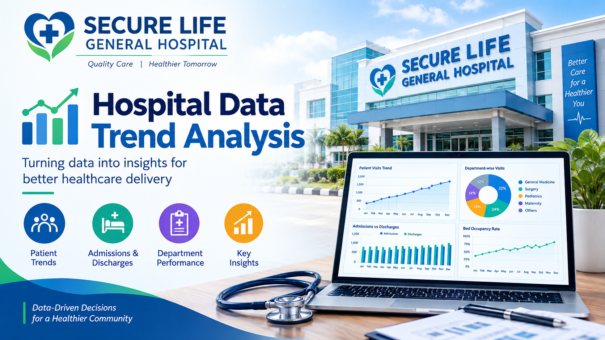
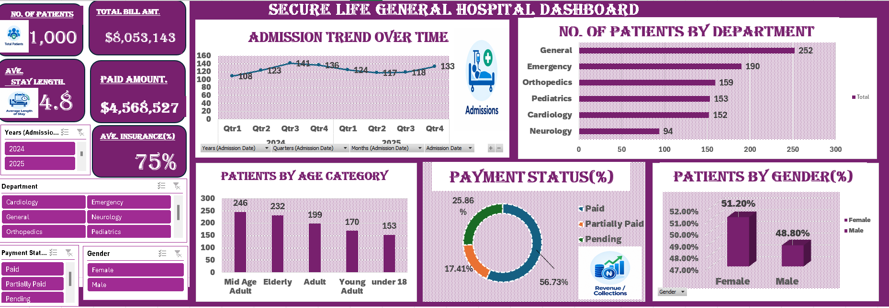

# SECURE LIFE GENERAL HOSPITAL PERFORMANCE ANALYSIS DASHBOARD.

## INTRODUCTION

Healthcare organizations rely on accurate and timely information to improve patient care, optimize operations, and maintain financial sustainability. Secure Life General Hospital seeks to understand patterns in patient admissions, departmental performance, billing, insurance coverage, and payment statuses.
This analysis transforms raw hospital patient data into meaningful insights through interactive dashboards and visual reports. The findings will support data-driven decision-making, improve revenue management, identify operational bottlenecks, and enhance overall hospital performance.

## 3. ABOUT THE DATA
The dataset contains detailed patient records and billing information collected from various hospital departments. Each record represents a patient visit and includes demographic, clinical, financial, and insurance-related information.

**Key Fields**

Field	Description

Patient ID	Unique identifier for each patient record

Patient Name	Name of the patient

Age	Patient's age

Gender	Patient's gender

Admission Date	Date of hospital admission

Discharge Date	Date of discharge

Department	Department where treatment was received

Diagnosis	Medical condition diagnosed

Total Bill Amount	Total treatment cost incurred

Insurance Coverage (%)	Percentage of bill covered by insurance

Payment Status	Paid, Pending, or Partially Paid

## PROBLEM STATEMENT
Secure Life General Hospital has experienced fluctuations in patient admissions, variations in insurance coverage, and increasing concerns regarding outstanding medical bills. Despite possessing large volumes of patient and financial data, management lacks a centralized reporting system that provides a comprehensive view of operational and financial performance.

Without clear visibility into departmental performance, payment trends, insurance utilization, and patient demographics, management faces challenges in making informed strategic decisions.

The objective of this analysis is to develop an interactive dashboard that consolidates patient admissions, billing, and insurance information to:

•	Monitor hospital performance.

•	Track revenue generation and outstanding payments.

•	Assess departmental efficiency.

•	Evaluate insurance coverage patterns.

•	Identify areas requiring managerial intervention.

•	Support evidence-based decision-making.

## VISUALIZATION

KPI Cards
Display high-level metrics such as:

•	Total Patient Visits

•	Total Revenue Generated

•	Outstanding Bills

•	Average Length of Stay

•	Average Insurance Coverage

•	Percentage Paid Bills

**Charts and Visuals**

**1. **Patient Visits by Department****
   
Visual: Clustered Bar Chart

Purpose: Identify departments with the highest patient traffic.

**2.Total Bill Amount by Department**

Visual: Horizontal Bar Chart

Purpose: Determine departments contributing most to hospital revenue.

**3. **Average Length of Stay by Department****
   
Visual: Column Chart

Purpose: Compare treatment duration across departments.

**5. **Payment Status Distribution****
   
Visual: Pie or Donut Chart

Categories:

•	Paid

•	Pending

•	Partially Paid

Purpose: Evaluate payment collection performance.

**6. **Total Revenue vs Outstanding Bills****
   
Visual: Stacked Column Chart

Purpose: Monitor financial health and unpaid balances.

**7. **Insurance Coverage by Department****
   
Visual: Heat Map or Column Chart

Purpose: Compare insurance utilization across departments.

**8. **Insurance Coverage by Diagnosis****
    
Visual: Bar Chart

Purpose: Understand which medical conditions receive higher insurance support.

**9. **Patient Visits by Age Group****
    
Visual: Bar Chart

Age Categories:

•	0-17 = Under 18

•	18-35 =  Young Adult

•	36-50 = Mid Age Adult

•	51-65 = Adult

•	66+ = Elderly 

Purpose: Identify dominant patient demographics.

**10. **Monthly Admission Trend****
    
Visual: Line Chart

Purpose: Track growth or decline in hospital admissions over time.

**11. **Monthly Billing Trend****
    
Visual: Line Chart

Purpose: Monitor revenue performance patterns over time.

**12. Diagnosis Analysis**
Visual: Treemap
Purpose: Display the most common diagnoses and their contribution to admissions.

**13. **Gender Distribution****
Visual: Donut Chart
Purpose: Compare male and female patient representation.

**Dashboard Filters** 

•	Admission Year

•	Department

•	Gender

•	Age Group

•	Diagnosis

•	Payment Status

## INSIGHTS
The following insights are expected from the analysis:

**Operational Insights**

•	Departments with the highest patient volumes indicate areas experiencing greater demand and resource utilization.

•	Longer average stays may reveal complex medical cases, resource constraints, or discharge delays.

•	Certain diagnoses may account for a significant proportion of admissions and require specialized attention.

**Financial Insights**

•	Revenue concentration may be heavily dependent on a few departments.

•	High outstanding balances can negatively impact hospital cash flow.

•	Departments with high billing but low payment completion rates may require stricter collection processes.

**Insurance Insights**

•	Insurance coverage levels may vary significantly across departments and diagnoses.

•	Departments with low insurance support may expose patients to higher out-of-pocket expenses.

•	Some diagnoses may consistently receive higher insurance reimbursement than others.

**Demographic Insights**

•	Specific age groups may account for the majority of hospital visits.

•	Gender-based patterns may reveal differences in healthcare utilization.

•	Aging populations may contribute to higher length of stay and healthcare costs.

**Trend Insights**

•	Seasonal changes may influence admission rates.

•	Billing trends may increase alongside patient visit growth.

•	Periods with declining revenue despite increasing admissions may suggest billing inefficiencies.

 ## RECOMMENDATIONS
**Improve Revenue Collection**

•	Strengthen follow-up procedures for pending and partially paid bills.

•	Implement automated billing reminders for patients.

•	Establish clear payment plans for outstanding balances.

**Optimize Department Resources**

•	Allocate additional staff and equipment to high-volume departments.

•	Monitor departments with excessive patient stay durations to improve efficiency.

**Enhance Insurance Management**

•	Negotiate broader insurance partnerships to increase patient coverage.

•	Educate patients on available insurance options before treatment.

**Improve Patient Flow**

•	Review discharge processes to reduce unnecessary hospital stays.

•	Introduce departmental performance tracking to identify bottlenecks.

**Monitor High-Risk Areas**

•	Investigate departments with high outstanding bill ratios.

•	Focus management attention on departments showing declining admissions or revenue trends.

**Build a Data-Driven Culture**

•	Deploy a real-time interactive Power BI dashboard.

•	Conduct monthly performance reviews using dashboard insights.

•	Establish KPIs for admissions, billing, collections, and insurance utilization.

## CONCLUSION
The proposed dashboard will provide Secure Life General Hospital with a comprehensive view of its operational and financial performance. By consolidating patient admissions, billing records, insurance coverage, and payment status information, management can gain actionable insights into hospital activities and financial health.
The analysis will help identify high-performing departments, monitor revenue generation, track outstanding payments, evaluate insurance coverage effectiveness, and understand patient demographics. Ultimately, the dashboard will support strategic planning, improve resource allocation, enhance revenue management, and enable the hospital to deliver better healthcare services while maintaining financial sustainability.

